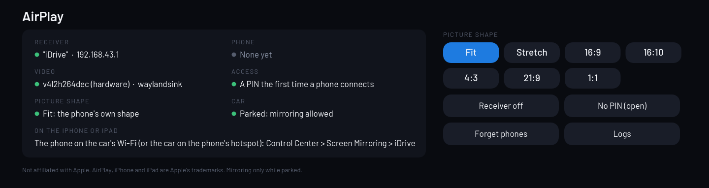
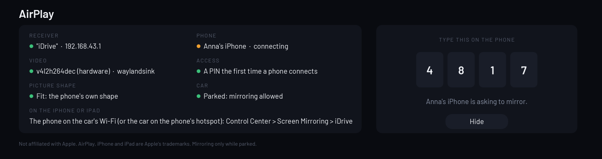
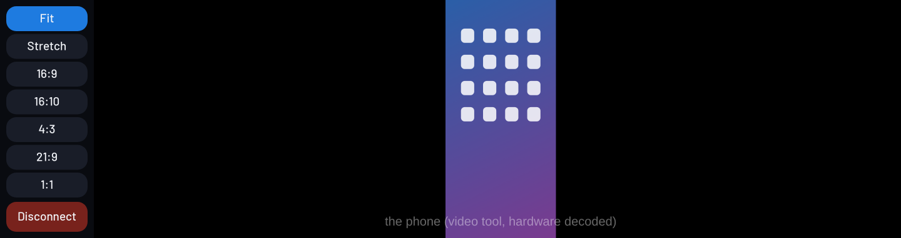
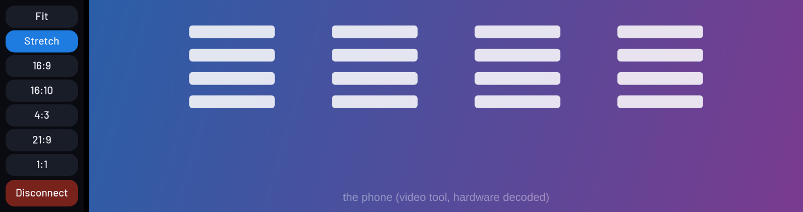

# AirPlay: your iPhone's screen on the car's screen, parked

An iDrive 8 app and a root tool that make the car an **AirPlay screen-mirroring receiver**. On the iPhone or iPad:
**Control Center > Screen Mirroring > iDrive**, and the phone's screen appears on the centre screen, decoded by the
head unit's hardware decoder. An **aspect ratio button** sets the picture's shape: **Fit**, **Stretch**, **16:9**,
**16:10**, **4:3**, **21:9** or **1:1**, and it changes at once while the phone mirrors.

| Home | A new phone: the PIN |
|---|---|
|  |  |
|  |  |

> **⚠️ Experimental, untested on a car or with an iPhone.** Every part runs and is tested on a desktop: the engine
> announces itself and answers an iPhone's first request, and the video tool's shapes and restarts are checked with
> a real H.264 stream. The AirPlay pairing and mirroring code is UxPlay's, which is widely used, but the whole chain
> (iPhone, car, head-unit decoder) hasn't been tried together yet.

> **Only while parked.** The receiver is on only while the app is open and the car reports 0 km/h. Anything over
> 3 km/h drops the phone and the picture at once. So does losing the speed signal.

## The parts

| Component | What it does |
|---|---|
| `ida_airplay` (app) | The screens, the picture's shape, the PIN, parked-only mirroring |
| `ida-airplay-engine` (tool, root, **GPL-3.0**) | The AirPlay receiver: announces the car on its Wi-Fi, pairs with the phone, receives its screen. Built on [UxPlay](https://github.com/FDH2/UxPlay)'s AirPlay library |
| `ida-remoteplay-video` (tool, root) | Remote Play's video tool, 1.2.0 or later: the head unit's GStreamer and **hardware decoder**, now with the shapes |

```
iPhone ──AirPlay (Wi-Fi)──▶ ida-airplay-engine ──H.264──▶ ida-remoteplay-video ──▶ hardware decoder ──▶ the screen
                                     ▲                            ▲
                                     └──── ida_airplay (app) ─────┘   start/stop, the shape, the PIN
```

## Use

1. In MGU Store, add the source `grabandrey/idrive-apps` (branch `main`) if you haven't, and install **AirPlay**
   (`ida_airplay`, which installs **AirPlay Engine** and **Remote Play Video** first). For the drawn screens, also
   install **Renderer** (`mgu-render`) from MGU Store's own source.
2. Put the phone and the car on the same Wi-Fi: the car's Wi-Fi (the one wireless CarPlay uses works), the **car's
   hotspot**, or the car on the **phone's hotspot**.
3. Park, and open **AirPlay** on the car, and keep it open: the receiver is on only while the app is on the screen.
   The Receiver row says `"iDrive" · through the car's Bonjour` (or the networks it announces on) when it's ready.
4. On the phone: **Control Center > Screen Mirroring > iDrive**. The first time, the car shows a 4-digit PIN:
   type it on the phone. The car remembers the phone after that.
5. The phone's screen fills the screen right of the band. Pick its shape in the band; **Disconnect** drops the phone.

### The picture's shape

| Button | The picture |
|---|---|
| **Fit** | The phone's own shape, as large as the screen allows (a phone held upright is tall and narrow; turned on its side it's wide) |
| **Stretch** | The whole screen, whatever the phone's shape |
| **16:9**, **16:10**, **4:3**, **21:9**, **1:1** | That shape, as large as the screen allows, centred |

The shape is kept for next time. It's on the Home screen too, and in the plain HMI list (**Picture shape**: each press
the next one), which works with the iDrive controller.

How it works: the video tool puts the picture in a rectangle of that shape (`render-rectangle`) and gives the picture
the pixel aspect ratio that makes it that shape (`capssetter`, before the decoder), so a display element that keeps a
picture's own shape fills the rectangle too. A shape changed while the phone mirrors starts the pipeline again and
hands it the stream from its last keyframe, so the picture is back at once. The same happens when the phone turns:
its picture changes size, and the shape is worked out again. If the head unit's GStreamer has no `capssetter`, the
logs say so: the rectangle alone sets the shape then, which works with displays that scale to it.

### Access

- **A PIN the first time** (the default): a phone the car hasn't seen shows a PIN prompt; the car shows the PIN.
  **Forget phones** makes every phone ask again.
- **Open** (**No PIN** on Home): any phone on the network can mirror. Everyone on your hotspot can see the car.

### Sound

Not played. The car's audio belongs to BMW's system, so the phone's sound goes nowhere while it mirrors.

## The engine

`engine/` is the receiver: `engine.c`, a small program around UxPlay's library (`lib/`: the AirPlay HTTP/RTSP server,
pairing, FairPlay, the mirror stream), linked **unmodified** from upstream at a pinned commit, with libplist (also the
engine's JSON) and OpenSSL's libcrypto. Each frame (H.264, Annex B) goes to the video tool's stream socket, with the
app's place and shape in the header line.

**Finding the car.** UxPlay's own mDNS responder answers on one interface, the one the default route uses. A head unit
has several, and the phone is rarely on the default one. So `mdns_ifaces.c` takes its place (same interface):

1. When the head unit runs Apple's Bonjour daemon (mDNSResponder: wireless CarPlay runs on it), the receiver is
   registered with it, over its socket, the way `DNSServiceRegister` does. The daemon then announces it on every
   network it serves, the CarPlay Wi-Fi link included, over IPv4 and IPv6.
2. Otherwise it answers itself, on **every interface** that's up, over **IPv4 and IPv6** (the link-local address: what
   an iPhone on the car's Wi-Fi reaches), each with that interface's own address, and looks for new interfaces every
   5 s (a hotspot that comes up later).

`/var/opt/ida-airplay-engine/env` can change that: `IDA_MDNS_IFACES=wlan0,uap0` (only these), `IDA_MDNS_SKIP=eth0`
(not these), `IDA_MDNS_SYSTEM=0` (never the head unit's daemon), `IDA_MDNS_SOCKET=/path` (its socket, elsewhere).

The phone is told the screen is 1920x1080 at up to 60 fps. It sends its own shape inside that.

Because it links UxPlay's library, the engine is **GPL-3.0** (`engine/LICENSE`). Its source and build script are
installed with it on the car, and the other libraries' licences are in `engine/licenses/`. The rest of this repository
stays MIT.

`engine/bin/x86_64/` and `engine/bin/aarch64/` hold the programs, static (musl). `start.sh` picks the right one. To
rebuild them:

```
pip install ziglang                       # and git, make, perl
packages/airplay/engine/build.sh          # both, or: build.sh x86_64 | aarch64 | native
```

`build.sh` clones UxPlay (commit `48f5ce4`), libplist 2.7.0 and OpenSSL 3.0.15, and builds everything with `zig cc`.

The app talks to it on `/run/ida-airplay-engine/engine.sock`, in JSON lines (see `app/src/links.js`):

| → engine | ← reply / event |
|---|---|
| `{"op":"hello"}` | `{"ok":true,"name","version","deviceId"}` |
| `{"op":"start","name":"iDrive","access":"pin"\|"open","video":{"socket","rect","aspect"}}` | `{"ok":true,"name","port"}` |
| `{"op":"view","video":{"aspect","rect"}}` | for the next stream |
| `{"op":"stop"}`, `{"op":"status"}`, `{"op":"forget"}` | |
| | `{"ev":"client","name","model","deviceId"}`, `{"ev":"pin","pin":"1234"}`, `{"ev":"conn","open":1}` |
| | `{"ev":"mirror","state":"started"\|"paused"\|"resumed"\|"stopped","width","height","codec","reason"}` |

And to the video tool, `{"op":"view","aspect":"4:3"}` on `/run/ida-remoteplay-video/ctl.sock` changes the playing
stream's shape.

## Settings and logs

- App: `airplay.json` (the receiver's name, access, shape, on or off) and `airplay.log`, in the first writable folder
  of the app's home, its working folder and the temp folder. The **Logs** screen shows the same lines, as does the
  head unit's log (`ARPL`). The name can be changed in `airplay.json` (`"name": "M2"`).
- Engine: `journalctl -u ida-airplay-engine`: each network it announces on, each phone, the PIN, the stream. Its
  identity (`id`, `airplay.pem`) and the phones that typed the PIN (`clients.txt`) are in `/var/opt/ida-airplay-engine/`.
- Video tool: see [Remote Play](../remoteplay/README.md#settings-and-logs).

**If the phone doesn't list "iDrive"** under Screen Mirroring:

- The app must be open on the car's screen, the car parked, and the receiver on. The Logs screen says
  `receiver on: "iDrive"` and `the phone finds the car ...` (through the car's Bonjour, or which networks).
- With wireless CarPlay on, the phone's Wi-Fi link to the car is CarPlay's. If "iDrive" still doesn't show, try the
  car on the phone's hotspot instead (CarPlay off for that phone, or over USB).
- `journalctl -u ida-airplay-engine` has each network it announces on (`mdns: on wlan0 (...)`) or the Bonjour daemon
  it registered with. If it's listed but won't connect, the head unit's firewall may be blocking it.

## Package layout

```
app/                       the app (source package, id ida_airplay, built on the head unit)
  src/ida_airplay.js       the app: the receiver on and off, the phone, the PIN, the shape, parked-only mirroring
  src/ui.js                the drawn screens: home (and the PIN), mirror, logs
  src/links.js             the video tool's and the engine's sockets (Remote Play's JsonLink)
  src/gate.js              parked or not, from the speed (Remote Play's)
  src/gpu.js, ui_font.js, log_ring.js, someip_link.js
                           Seat Lights' (the same files; the test fails when they differ)
  tools/test_airplay.js    tests: the screens, the shapes, the links, the package, and the engine (its component,
                           both programs, and the real x86_64 one answering the app, mDNS and /info)
  tools/preview_ui.js      design/app_<screen>.html (home | pin | mirror | stretch | logs)
  tools/gen_package.js     the package tree
engine/                    the root tool (id ida-airplay-engine), GPL-3.0
  engine.c                 the engine: the socket, the receiver, the video out
  mdns_ifaces.c            the mDNS responder: every private network, each with its own address
  build.sh                 builds bin/<arch>/ida-airplay-engine from upstream sources
  start.sh                 runs the one for this processor
  bin/x86_64, bin/aarch64  the built programs (static)
  LICENSE, licenses/       GPL-3.0; the linked libraries' licences
```

Not affiliated with Apple. AirPlay, iPhone and iPad are Apple's trademarks, named here only to say what the app works
with. MIT licensed, except `engine/` (GPL-3.0).
