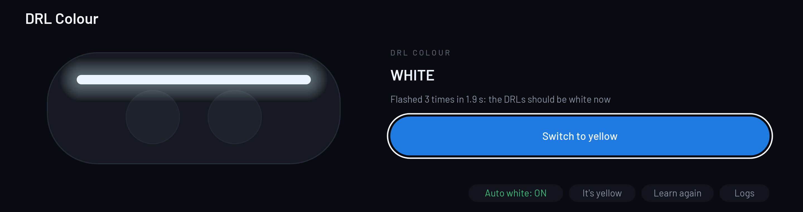

# DRL Colour: yellow or white DRLs from the screen

An iDrive 8 app for aftermarket DRL modules that change colour when you **flash the high beams three times**. One
button flashes them for you: **Switch to white** / **Switch to yellow**. **Auto white** (off until you switch it on)
does it by itself at each engine start.



> **⚠️ Experimental, untested on a car.** It drives the high beams the way [Seat Lights](../seatlights) holds the
> seat logos (the body controller's lamp outputs, through the head unit's diagnostic link), but which outputs the
> high beams are differs from car to car, so the app learns them first. On some cars (LED/laser lights whose high
> beam is switched inside the headlight module) the high beams may not be body controller lamp outputs at all: then
> learning says so, and this app can't work on that car.

## Use

1. In MGU Store, add the source `grabandrey/idrive-apps` (branch `main`) if you haven't, and install **DRL Colour**
   (`ida_drlcolor`). For the drawn screen, also install **Renderer** (`mgu-render`) from MGU Store's own source.
   Without it, the screen is the head unit's plain list with the same buttons as rows.
2. **The first time: Learn.** Car standing, ignition on (engine running is best), lights on auto or low beam.
   Open DRL Colour and press **Learn the high beams first**. When it says *Now flash the high beams 3 times with the
   stalk*, pull the stalk three times within the 8 seconds. The app watches the body controller's lamp outputs and
   keeps the ones that went on and off with each pull (usually two: left and right).
   It then flashes them **once** itself to find the request layout the body controller takes, and says
   *Learned: the high beams are lamp outputs X and Y. Ready*. That single check flash may count towards your
   module's three: wait a few seconds before the first switch.
3. **Switch.** Press **Switch to white**. The high beams flash three times (about 2 seconds) and the app counts the
   colour as white. Pressing again switches back to yellow.

The app can't read the colour from your module, it counts flashes. If it shows the wrong colour (you used the stalk
yourself, a flash didn't take), press **It's white** / **It's yellow** to correct it; nothing is flashed.

**Auto white** is for modules that come back **yellow every time the car is off**: at each engine start, about
4 seconds later and once the car stands still, it flashes three times. If your module remembers its colour, leave
it off, or it would switch your white DRLs back to yellow at every start.

Only with the car standing (3 km/h or less). On the move, use the stalk.

### If your module wants different timing

Each flash is 250 ms on, 350 ms off. To change it, add `"onMs"`, `"offMs"` (milliseconds) or `"count"` to
`drlcolor.json` (next to `drlcolor.log`, in the app's home folder) and restart the app. The Logs screen says how
long each switch took.

## How it works

Through the head unit's diagnostic link (`InternalTasu`) to the body controller (BDC, `0x40`), as Seat Lights and
the MIT-licensed [idrive7-apps](https://github.com/cauliflowermossgrape/idrive7-apps) kit do it:

| Step | Request |
|---|---|
| learn: the lamp outputs, before and every 150 ms for 8 s | `22 E3B9` (`22 4500` on older BDCs) |
| learn: the layout, one flash of the first output, read back | `10 03`, `2F E3B5 <layout, on>`, `22 E3B9`, `2F E3B5 <layout, back>`, `10 01` |
| switch: the extended session | `10 03` |
| 3 times: every high beam output on, 250 ms, every output back, 350 ms | `2F E3B5 <layout, on>` … `2F E3B5 <layout, back>` |
| the default session | `10 01` |

The layouts tried are Seat Lights' (`03 <el> 01`, `03 00 <el> 01`, `03 <el> 01 00`, `03 <el> 00 01`, element = output
number − 1); a layout is kept only if it lights the output with nothing else switching on. Outputs, layout and
identifier are saved in `drlcolor.json` and used directly from then on (**Learn again** to redo it).

`uds.js` (Light Logger's, the same file) lets through reads, the sessions, and on/back for one named output at a
time to the body controller only. Anything else is refused before it reaches the car.

| Situation | What the app does |
|---|---|
| anything refused during a switch | every output handed back at once, the session ended, the colour left as it was; the screen says what the body controller answered |
| the car moving | doesn't flash or learn (Auto white waits for the car to stand) |
| the app stopping mid-switch | stops after the current flash, hands the outputs back |
| the app crashing | the body controller ends the session after a few seconds and takes the outputs back itself |

Don't use a diagnostic or coding tool on the car while it switches. Logs: the **Logs** screen, `drlcolor.log`, and
the head unit's log (`DRLC`), lines starting `drl:`.

## Package layout

```
app/                        the app (source package, id ida_drlcolor, built on the head unit)
  mgu-app.json              id, version, modules, the oap-sdk modules it uses
  src/ida_drlcolor.js       the app: the buttons, the screen, the settings, the engine and speed
  src/flasher.js            learning the high beam outputs and the layout; the three flashes; Auto white
  src/ui.js                 the drawn screen: the headlight in its DRL colour, the button
  src/log_ring.js           Seat Lights' log (the Logs screen, drlcolor.log)
  src/uds.js, lamps.js, someip_link.js, gpu.js, ui_font.js
                            Light Logger's, copied as they are; tools/test_drlcolor.js fails when they differ
  package/                  the staged package tree (generated by tools/gen_package.js)
  tools/test_drlcolor.js    tests: learning and flashing against a fake body controller, the screen, the package
  tools/preview_ui.js       writes design/app_preview.html (yellow | white | flashing | learn | logs)
```

Not affiliated with BMW. MIT licensed.
