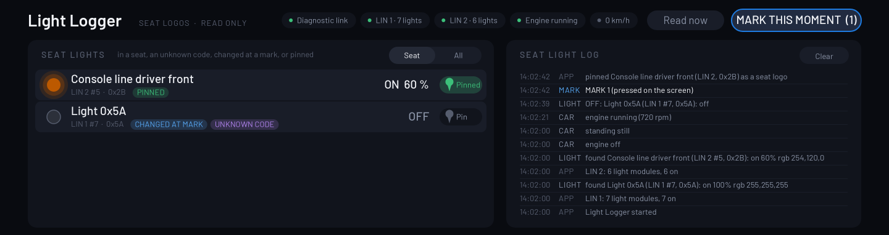

# Light Logger: what switches the seat logos off

An iDrive 8 app for **finding out** why the illuminated logos in the seats (G87 M2 headrests) go dark once the
car is started. It watches the car's interior light modules and logs every change next to the engine and the
car's speed. It changes nothing on the car.

> **⚠️ Experimental: not yet tested on a car.** It follows the documented MGU Store format and reads the light
> modules the way the MIT-licensed [idrive7-apps](https://github.com/cauliflowermossgrape/idrive7-apps) kit's Ambient
> config app does (tested there on a G20). It passes desktop tests against stand-ins for BMW's SDK, but hasn't run on
> a G87 yet. **The seat logos may not be on these buses at all.** Whether they are is what the log is for.



## What it does

- Every 4 s it reads both LIN buses of the body controller (BDC, `22 DA5F` and `22 E3D1`) through the head unit's
  own diagnostic link (`InternalTasu`). That gives every ambient light module the BDC drives, each with its place,
  colour, brightness and faults.
- It follows the engine (`CDS.statusEngineSpeed2`) and the car's speed (`Vehicle2.statusCarSpeed2`).
- Each change becomes an event: a module found, switched **ON** or **OFF**, dimmed or recoloured, or gone; the
  engine running or off; the car moving or standing still. Lights in or on a seat (driver / passenger seat back,
  and the second row's) are marked **SEAT** (`>>` on the screen).
- **Mark this moment**: press it the second you see the logo go dark. A MARK line lands in the log, so you can
  line it up with what the car did.
- **Only the seat lights on screen.** Of all the modules, it shows only the ones that may be the logos, each with
  why:

  | Tag | Why it's shown |
  |---|---|
  | **PINNED** | you pinned it as a logo (tap **Pin**; kept across restarts) |
  | **SEAT** | its location is a seat in the BDC_G05 table (driver / passenger seat back, second row) |
  | **CHANGED AT MARK** | it switched on or off, or changed, from 25 s before a mark to 15 s after it |
  | **UNKNOWN CODE** | the table doesn't know its location. The G87's logos may be one of these |

  The log beside them shows only those lights' events, the car's and your marks. **All** shows every module, and
  the text file keeps everything.
- **It starts with the head unit**, so the welcome light at unlocking is logged before you open the app.

### The screen

With MGU Store's **Renderer** (`mgu-render`) installed, the app draws its own screen (above): the seat lights on
the left, the seat light log on the right, **Read now** and **Mark this moment** at the top. Touch works, and the
controller moves between the buttons. Without the Renderer it shows the head unit's plain list. **Show** steps
through *Seat lights now*, *Seat light log* and *All lights now*.

**Read only.** The app sends nothing but `ReadDataByIdentifier` (22) to one control unit. `uds.js` refuses
anything else before it reaches the car, and the tests check that no other module sends requests.

## Install (MGU Store)

1. In MGU Store, **Settings → Add source**, enter `grabandrey/idrive-apps`, branch `main` (skip if already added).
2. Install **Light Logger** (`ida_lightlog`). It needs nothing else.
3. Open **Light Logger** from the Apps menu. It logs while it runs.

## How to use it on the G87

1. Lock the car, wait a minute, unlock it and get in. Open Light Logger before you start the engine. The seat
   logos should be lit (welcome light).
2. Look at **Seat lights**. If it says *No seat light so far*, no module has a seat location or an unknown code:
   the G87 may give its logos a code the table names as something else, or they may not be on these buses.
3. Start the engine, and drive off if that's when the logos go dark. Press **Mark this moment** the instant they do.
4. Any light that changed around the mark now shows as **CHANGED AT MARK**. If it's the logo, **Pin** it: from then
   on it's always listed first and its changes stay in the seat light log.
5. Read the seat light log around the mark: what went **OFF**, and right after what (engine running, moving, a
   number of seconds after unlocking).

What the answer means:

| What the log shows | What it means |
|---|---|
| A `SEAT` (or `Light 0x..`) module goes OFF at the mark | The logos are BDC ambient light modules. An app could switch them on again over the same link, and that's the next step |
| Nothing changes at the mark | The logos aren't on the BDC's LIN buses (wired to the seat or another unit). An iDrive app can't reach them this way. Coding or wiring is the route |
| `the body controller refuses the read` / `stopped answering` | This car's BDC doesn't offer these reads (or another app holds the link). The log says which |

## Where the log goes

- On the screen: the seat lights and their events (or every module, with **All**).
- A text file, `lightlog.txt`, in the first writable folder of the app's home, its working folder and the temp
  folder. The status line shows the path. It is restarted (the old one kept as `.1`) past 1 MB.
- The app's log (`LTLG`), each line starting `LIGHT`, plus each bus's raw reply whenever it changes.

## Good to know

- Don't run it together with an ambient light app that writes these modules (Ambient config, IterioDev's
  Comfort). The diagnostic link takes one request at a time, and their colours would show up as changes here.
- The BDC answers each read after a second or two (`7F 22 78`, then the reply), so a change shows up within about
  5–10 s, not instantly.
- The location names come from the BDC_G05 description through the idrive7-apps kit. The G87's may differ.

## Package layout

```
app/                         the app (source package, id ida_lightlog, built on the head unit)
  mgu-app.json               id, version, modules, the oap-sdk modules it uses
  src/ida_lightlog.js        the app: polling, the screen, the log
  src/uds.js                 the diagnostic link (read only)
  src/lin.js                 the BDC's light module records -> modules
  src/journal.js             reads and car data -> events
  src/screen_model.js        what the screen shows: the seat lights, their log, the plain list's rows
  src/ui.js, src/ui_font.js  the drawn screen (draw ops for the renderer) and its glyphs (scripts/bake_font.py)
  src/gpu.js                 the connection to the head unit's renderer (mgu-render), copied from Vitals
  src/someip_link.js         BMW's typed SOME/IP proxies
  src/log_file.js            the text file
  package/                   the staged package tree (generated by tools/gen_package.js)
  tools/test_lightlog.js     tests: records, the read-only link, the journal, the seat filter, the screens, the manifest
  tools/preview_ui.js        writes design/app_preview.html: the drawn screen with a sample drive
design/app_preview.html      the drawn screen in a browser (add  seat | empty | all  to preview_ui.js for the others)
```

`node packages/lightlog/app/tools/gen_package.js` after changing the screen, the manifest or the version.

## Credits

The diagnostic link's request format, the BDC's light module identifiers and their location names follow the
MIT-licensed [idrive7-apps](https://github.com/cauliflowermossgrape/idrive7-apps) kit (`kit/runtime/diag.js`,
`apps/ambient_config/lin.js`). Not affiliated with BMW. MIT licensed.
