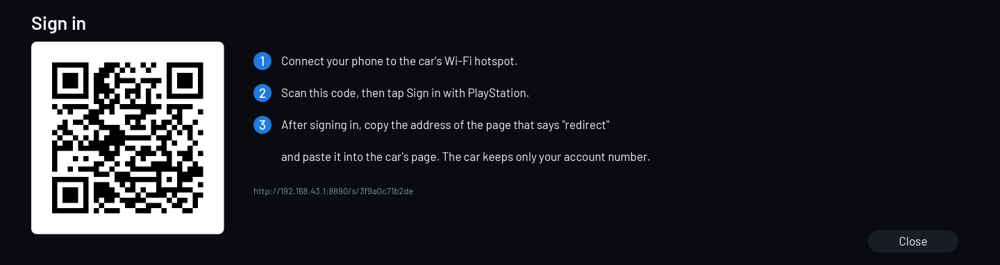
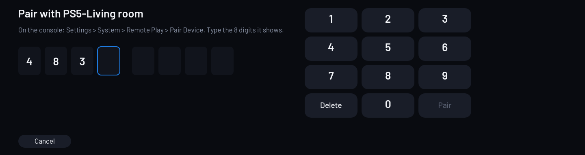

# Remote Play: your PlayStation on the car's screen, parked

An iDrive 8 app and root tools that put your PlayStation on the car's centre screen, for when you're parked and
waiting: **your PS5 at home, over the internet**, or a console on the car's own network. Sign in with a QR code
from your phone, and play with the touch controls or a USB gamepad plugged into the car.

| Away from home | Play |
|---|---|
|  |  |
|  |  |

> **⚠️ Experimental, untested on a car or with a console.** Every part runs and is tested on a desktop. The engine's
> pairing and session code is chiaki-ng's, which is widely used, but the whole chain (car, console, head-unit
> decoder) hasn't been tried together yet.

> **Only while parked.** Play and the video test start only when the car reports 0 km/h. Anything over 3 km/h
> stops the game and the video at once. So does losing the speed signal.

## The parts

| Component | What it does |
|---|---|
| `ida_remoteplay` (app) | The screens, sign-in, finding and waking the console, pairing, the touch controls, parked-only play |
| `ida-remoteplay-video` (tool, root) | Shows the video **at the stream's full frame rate** through the head unit's own GStreamer and **hardware decoder**, and reads a **USB gamepad** |
| `ida-remoteplay-engine` (tool, root, **AGPL-3.0**) | The console's Remote Play session: pairing, the encrypted stream, the controller back to the console. Built on [chiaki-ng](https://github.com/streetpea/chiaki-ng)'s library |

**Why a root tool for the video:** an app can only draw through the Renderer, a few pictures a second, with no
decoder. Full frame rate needs the head unit's own video hardware. The tool starts a GStreamer pipeline:

```
fdsrc ! h264parse ! <hardware decoder> ! <display> render-rectangle=<the middle of the Play screen> sync=false
```

`sync=false` shows each frame as soon as it arrives, so the console sets the frame rate (60 fps), not a clock.
Decoders are tried in this order: `v4l2h264dec`, `v4l2slh264dec`, `omxh264dec`, `vaapih264dec`, `nvv4l2decoder`,
`imxvpudec_h264`, … and `avdec_h264` last (software, rarely 60 fps). H.265 is used when the head unit decodes it
in hardware. Displays are tried in this order: `waylandsink`, `glimagesink`, `kmssink`, … The Home screen shows
what was found.

## Use

1. In MGU Store, add the source `grabandrey/idrive-apps` (branch `main`) if you haven't, and install **Remote Play**
   (`ida_remoteplay`, which installs **Remote Play Video**, `ida-remoteplay-video`, and **Remote Play Engine**,
   `ida-remoteplay-engine`, first). For the drawn screens,
   also install **Renderer** (`mgu-render`) from MGU Store's own source.
2. **Your PS5 at home** (once, on the console): *Settings > System > Remote Play*: **Enable Remote Play** on; and
   *Settings > System > Power Saving > Features Available in Rest Mode*: **Stay Connected to the Internet** and
   **Enable Turning On PS5 from Network** on. Then leave it in rest mode when you go out.
3. **Video test** (Home): an 8-second moving picture at 1280×720, 60 fps. With an encoder on the head unit, it's
   encoded and decoded the way a stream is. The result is the frame rate the car really shows. Do this first: it
   shows whether full frame rate works on your head unit, before any console is involved.
4. **Sign in**: a QR code. With your phone on the car's hotspot, scan it, tap **Sign in with PlayStation**, sign in
   at Sony, then copy the address of the page that ends on *redirect* and paste it into the car's page. The car
   keeps your account's number and a PSN sign-in token (see [Your PSN sign-in](#your-psn-sign-in)). Your
   password stays with Sony.
5. **Find console**: the car asks PSN for the consoles on your account and picks your PS5. The Console row then
   says *at home, over the internet*, and the button says **Play over the internet**. No PIN is needed: over PSN,
   the console pairs itself for each session.
6. **Play**. **Exit** (bottom left) ends it.

**A console on the car's network** (for example a PS5 you brought along, on the car's hotspot) is used instead
whenever it answers there. Pair it once with **Pair** (*Settings > System > Remote Play > Pair Device*, the 8 digits
it shows). **Wake** wakes it from rest mode.

### Over the internet

The car needs an internet connection the engine can use: the car's own connectivity, or the car on your phone's
hotspot. PSN tells your PS5 to open a session. Then the engine and the console punch through the routers on both
sides (UPnP where your home router offers it, then STUN). On mobile networks, which rewrite ports, it also guesses
ports, the way chiaki-ng does for hotspots.

- **Data:** the stream asks for 6 Mbit/s over the internet (10 at home), about **2.7 GB an hour** at 720p 60 fps. On
  a weak connection the console lowers the quality itself.
- **It may not get through** some mobile networks (carrier NAT that blocks hole punching). The log then says which
  step failed (`over the internet: punching through the routers failed`). Your phone's hotspot is the other way to
  try.
- Delay is higher than at home. Fine for most games, harder for fast shooters.

If the console asks for a login PIN when a device connects, the stream ends with a message saying so. Switch the
PIN off on the console to play from the car.

### The controls

The game fills the middle of the screen at 16:9. The controls sit beside it: L1/L2, the left stick and the d-pad on
the left, R1/R2, the face buttons and the right stick on the right, then Create, PS and Options.
**The Renderer reports one touch at a time,** so you can't hold a stick and press a button together. For real
games, plug a **USB gamepad** into the car (a DualSense or DualShock 4 by cable, or another standard pad). The
video tool reads it straight from the kernel, it takes over from the touch controls, and only Exit stays on screen.

## The engine

`engine/` is the stream engine: `engine.c`, a small program around chiaki-ng's Remote Play library (pairing with
`chiaki_regist`, the session with `chiaki_session`). Each video frame (H.264 or H.265, Annex B) goes to the video
tool's stream socket, and each controller state from the app becomes the session's controller state. The library is
linked **unmodified**, from upstream at a pinned commit.

Because it links chiaki-ng, the engine is **AGPL-3.0** (`engine/LICENSE`). Its source and build script are installed
with it on the car, and the other libraries' licences are in `engine/licenses/`. The rest of this repository stays MIT.

`engine/bin/x86_64/` and `engine/bin/aarch64/` hold the programs, one per processor the head unit may have. They're
static (musl), so they don't depend on the head unit's libraries. `start.sh` picks the right one. To rebuild them:

```
pip install ziglang protobuf grpcio-tools     # and git, cmake, ninja, protoc
packages/remoteplay/engine/build.sh           # both, or: build.sh x86_64
```

`build.sh` clones chiaki-ng (commit `43728af`) and what it links (OpenSSL 3.0.15, libevent 2.1.12, json-c 0.17,
miniupnpc 2.2.8, and chiaki-ng's own curl, nanopb, jerasure and gf-complete) and builds everything with `zig cc`.
Two things differ from a desktop chiaki-ng build. `musl_compat.c` provides `pthread_clockjoin_np`, a glibc-only
function the library uses. And it uses OpenSSL, the library's default: its Mbed TLS option writes a 32-byte HMAC
into a 16-byte buffer and crashes during pairing.

The app talks to it on `/run/ida-remoteplay-engine/engine.sock`, in JSON lines (see `app/src/links.js`):

| → engine | ← reply / event |
|---|---|
| `{"op":"hello","proto":1}` | `{"ok":true,"name","version","targets":["ps5","ps4"]}` |
| `{"op":"register","host","type","accountId","pin"}` | `{"ok":true,"registered":{"registKey","rpRegistKey","rpKey","nickname","mac",…}}` (the app keeps it as given) |
| `{"op":"start","host","type","accountId","registered","video":{"socket","codec","width","height","fps","bitrateKbps","rect"}}` | events `{"ev":"session","state":"connecting"\|"streaming"\|"ended","reason"}` |
| `{"op":"input","state":{"buttons":["cross",…],"lx","ly","rx","ry","l2","r2"}}` | none (sent on each change, and every 0.5 s) |
| `{"op":"stop"}` | `{"ok":true}` |

The video goes to `/run/ida-remoteplay-video/stream.sock`: first one JSON line,
`{"codec":"h264","width":1280,"height":720,"fps":60,"rect":{…}}`, then the frames. The engine asks the console for
a keyframe whenever it opens that socket, so the decoder always starts on a full picture.

Over the internet: `{"op":"devices","token"}` lists the account's consoles (`{"devices":[{"name","consoleId","type","remotePlay"}]}`),
`{"op":"duid"}` makes this car's PSN device id (once, for the sign-in), and `start` takes
`"remote":{"token","consoleId","portGuessing"}` in place of `host` and `registered`. The PSN steps run on a thread
of their own, so Exit cancels them. The engine finds PSN's HTTPS certificates through `cacert.pem` (Mozilla's list,
shipped with it, MPL-2.0).

**Not yet:** sound. The engine runs the session with audio off, because the car's audio belongs to BMW's system.

## Your PSN sign-in

Playing over the internet needs PSN's permission each time, so the car keeps a **refresh token** from your
sign-in. Before each game it gets a short-lived access token from it, kept in memory only. Sony may rotate the
refresh token, and the car saves the new one.

The token is in `remoteplay.json`, readable by the app alone (mode 600), and it never leaves the car except to Sony.
**Sign out** (on the Sign in screen) deletes it. If Sony stops accepting it, the car forgets it and asks you to sign in
again. The permissions it asks Sony for are the four Remote Play needs: your account, the console list, PSN's push
channel, and Remote Play sessions.

## Settings and logs

- App: `remoteplay.json` (the account id and PSN token, the consoles, the pairing, the stream size) and
  `remoteplay.log`, in the first writable folder of the app's home, its working folder and the temp folder. The
  **Logs** screen shows the same lines, as does the head unit's log (`RMPL`).
- Engine: its log is in the journal (`journalctl -u ida-remoteplay-engine`): pairing, the session, and why it ended.
- Video tool: `/var/opt/ida-remoteplay-video/settings.json` can name the decoder and display, for example
  `{"decoder":{"h264":"omxh264dec"},"sink":"kmssink","sinkProps":"fullscreen=true"}`. Its log is in the journal
  (`journalctl -u ida-remoteplay-video`): what it found, each pipeline, and the frame rate.

The sign-in page runs on port 8890 only while the Sign in screen is open. A random token in its address keeps out
anyone else on the hotspot.

## Package layout

```
app/                       the app (source package, id ida_remoteplay, built on the head unit)
  src/ida_remoteplay.js    the app: the screens' actions, parked-only play, the parts together
  src/login.js             the sign-in page on the hotspot, Sony's code -> the account id
  src/qr.js                a QR code encoder (byte mode, level M, versions 1-10)
  src/discovery.js         finding and waking consoles (UDP 9302 / 987)
  src/links.js             the video tool's and the engine's sockets (JSON lines)
  src/pad.js               the touch controller: the layout, touches -> the controller state
  src/gate.js              parked or not, from the speed
  src/ui.js                the drawn screens: home, sign in, pair, play, logs
  src/gpu.js, ui_font.js, log_ring.js, someip_link.js
                           Seat Lights' (the same files; the test fails when they differ)
  tools/test_remoteplay.js tests: the QR code, sign-in, discovery, the links, the controls, the gate, the screens,
                           the video tool's pipelines and frame counting, the gamepad, the package, and the engine
                           (its component, both programs, and the real x86_64 one answering the app)
  tools/preview_ui.js      design/app_<screen>.html (home | signin | pin | play | logs)
  tools/gen_package.js     the package tree
tool/                      the root tool (id ida-remoteplay-video)
  video.js                 GStreamer: the probe, the video test, the stream pipeline
  gamepad.js               a USB gamepad from /dev/input
engine/                    the root tool (id ida-remoteplay-engine), AGPL-3.0
  engine.c                 the engine: the socket, pairing, the session, video out, controller in
  musl_compat.c/.h         pthread_clockjoin_np for musl
  build.sh                 builds bin/<arch>/ida-rp-engine from upstream sources
  start.sh                 runs the one for this processor
  bin/x86_64, bin/aarch64  the built programs (static)
  LICENSE, licenses/       AGPL-3.0; the linked libraries' licences
```

Not affiliated with Sony Interactive Entertainment. PlayStation, PS5, DualSense and DualShock are Sony Interactive
Entertainment's trademarks, named here only to say what the app works with. MIT licensed, except `engine/`
(AGPL-3.0).
