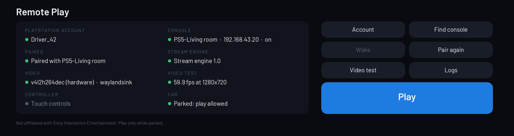
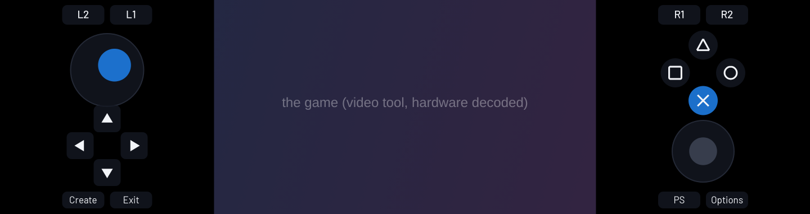

# Remote Play: your PlayStation on the car's screen, parked

An iDrive 8 app and a root tool that put your PlayStation on the car's centre screen, for when you're parked and
waiting. Sign in with a QR code from your phone, find and wake the console on the car's network, pair it with its
PIN, and play with the touch controls or a USB gamepad plugged into the car.

| Home | Play |
|---|---|
|  |  |
|  |  |

> **⚠️ Experimental, untested on a car. Playing needs a stream engine that this repository doesn't have yet (see
> [What's missing](#whats-missing)).** Sign-in, finding and waking the console, the video test, and the controls
> work without it.

> **Only while parked.** Play and the video test start only when the car reports 0 km/h. Anything over 3 km/h
> stops the game and the video at once. So does losing the speed signal.

## The parts

| Component | What it does |
|---|---|
| `ida_remoteplay` (app) | The screens, sign-in, finding and waking the console, pairing, the touch controls, parked-only play |
| `ida-remoteplay-video` (tool, root) | Shows the video **at the stream's full frame rate** through the head unit's own GStreamer and **hardware decoder**, and reads a **USB gamepad** |
| a stream engine (not in this repo) | The console's Remote Play session: pairing, the encrypted stream, the controller back to the console |

**Why a root tool for the video:** an app can only draw through the Renderer, a few pictures a second, with no
decoder. Full frame rate needs the head unit's own video hardware. The tool starts a GStreamer pipeline:

```
fdsrc ! h264parse ! <hardware decoder> ! <display> render-rectangle=<the middle of the Play screen> sync=false
```

`sync=false` shows each frame as soon as it arrives, so the console sets the frame rate (60 fps), not a clock.
Decoders are tried in this order: `v4l2h264dec`, `v4l2slh264dec`, `omxh264dec`, `vaapih264dec`, `nvv4l2decoder`,
`imxvpudec_h264`, … and `avdec_h264` last (software, rarely 60 fps). H.265 is used when the head unit decodes it
in hardware. Displays are tried in this order: `waylandsink`, `glimagesink`, `kmssink`, … The Home screen shows
what was found.

## Use

1. In MGU Store, add the source `grabandrey/idrive-apps` (branch `main`) if you haven't, and install **Remote Play**
   (`ida_remoteplay`, which installs **Remote Play Video**, `ida-remoteplay-video`, first). For the drawn screens,
   also install **Renderer** (`mgu-render`) from MGU Store's own source.
2. **The network:** the car and the PlayStation must be on the same network. The easy way is to turn on the car's
   Wi-Fi hotspot and connect the console to it. If the console stays home, it needs another way to reach the car:
   that's PSN's internet connection, which the stream engine would have to support.
3. **Video test** (Home): an 8-second moving picture at 1280×720, 60 fps. With an encoder on the head unit, it's
   encoded and decoded the way a stream is. The result is the frame rate the car really shows. Do this first: it
   shows whether full frame rate works on your head unit, before any console is involved.
4. **Sign in**: a QR code. With your phone on the car's hotspot, scan it, tap **Sign in with PlayStation**, sign in
   at Sony, then copy the address of the page that ends on *redirect* and paste it into the car's page. The car
   swaps the code for your account's number at Sony and keeps only that number (the console asks for it when
   pairing). No password or token is kept. If you already know your account ID (base64), the page takes it
   directly.
5. **Find console**, then **Pair**: on the PlayStation, go to *Settings > System > Remote Play > Pair Device* and
   type the 8 digits it shows.
6. **Play**. **Exit** (bottom left) ends it. **Wake** wakes a paired console from rest mode.

### The controls

The game fills the middle of the screen at 16:9. The controls sit beside it: L1/L2, the left stick and the d-pad on
the left, R1/R2, the face buttons and the right stick on the right, then Create, PS and Options.
**The Renderer reports one touch at a time,** so you can't hold a stick and press a button together. For real
games, plug a **USB gamepad** into the car (a DualSense or DualShock 4 by cable, or another standard pad). The
video tool reads it straight from the kernel, it takes over from the touch controls, and only Exit stays on screen.

## What's missing

**The stream engine.** It's the program that talks to the console: pairing (the PIN, the registration keys), the
session (Sony's encrypted UDP protocol), turning the console's packets into an H.264/H.265 stream, and sending the
controller back. It's large: the open-source client [chiaki-ng](https://github.com/streetpea/chiaki-ng) (AGPL-3.0)
is the reference. It isn't in this repository: it would be its own component under its own licence, built for the
head unit (aarch64 Linux). The app and the video tool are made so any engine that speaks the socket below can be
added without changing them.

`/run/ida-remoteplay-engine/engine.sock`, JSON lines (see `app/src/links.js`):

| → engine | ← reply / event |
|---|---|
| `{"op":"hello","proto":1}` | `{"ok":true,"name","version","targets":["ps5","ps4"]}` |
| `{"op":"register","host","type","accountId","pin"}` | `{"ok":true,"registered":{"registKey":"<hex>",…}}` (the app keeps it as given) |
| `{"op":"start","host","type","registered","video":{"socket","codec","width","height","fps","bitrateKbps","rect"}}` | events `{"ev":"session","state":"connecting"\|"streaming"\|"ended","reason"}` |
| `{"op":"input","state":{"buttons":["cross",…],"lx","ly","rx","ry","l2","r2"}}` | none (sent on each change, and every 0.5 s) |
| `{"op":"stop"}` | `{"ok":true}` |

The engine writes the video to `/run/ida-remoteplay-video/stream.sock`: first one JSON line,
`{"codec":"h264","width":1280,"height":720,"fps":60,"rect":{…}}`, then the Annex B elementary stream. Audio isn't
handled yet. The car's audio belongs to BMW's system, so an engine would need its own way to play it.

## Settings and logs

- App: `remoteplay.json` (the account id and nickname, the console, the pairing, the stream size) and
  `remoteplay.log`, in the first writable folder of the app's home, its working folder and the temp folder. The
  **Logs** screen shows the same lines, as does the head unit's log (`RMPL`).
- Video tool: `/var/opt/ida-remoteplay-video/settings.json` can name the decoder and display, for example
  `{"decoder":{"h264":"omxh264dec"},"sink":"kmssink","sinkProps":"fullscreen=true"}`. Its log is in the journal
  (`journalctl -u ida-remoteplay-video`): what it found, each pipeline, and the frame rate.

The sign-in page runs on port 8890 only while the Sign in screen is open. A random token in its address keeps out
anyone else on the hotspot.

## Package layout

```
app/                       the app (source package, id ida_remoteplay, built on the head unit)
  src/ida_remoteplay.js    the app: the screens' actions, parked-only play, the parts together
  src/login.js             the sign-in page on the hotspot, Sony's code -> the account id
  src/qr.js                a QR code encoder (byte mode, level M, versions 1-10)
  src/discovery.js         finding and waking consoles (UDP 9302 / 987)
  src/links.js             the video tool's and the engine's sockets (JSON lines)
  src/pad.js               the touch controller: the layout, touches -> the controller state
  src/gate.js              parked or not, from the speed
  src/ui.js                the drawn screens: home, sign in, pair, play, logs
  src/gpu.js, ui_font.js, log_ring.js, someip_link.js
                           Seat Lights' (the same files; the test fails when they differ)
  tools/test_remoteplay.js tests: the QR code, sign-in, discovery, the links, the controls, the gate, the screens,
                           the video tool's pipelines and frame counting, the gamepad, the package
  tools/preview_ui.js      design/app_<screen>.html (home | signin | pin | play | logs)
  tools/gen_package.js     the package tree
tool/                      the root tool (id ida-remoteplay-video)
  video.js                 GStreamer: the probe, the video test, the stream pipeline
  gamepad.js               a USB gamepad from /dev/input
```

Not affiliated with Sony Interactive Entertainment. PlayStation, PS5, DualSense and DualShock are Sony Interactive
Entertainment's trademarks, named here only to say what the app works with. MIT licensed.
