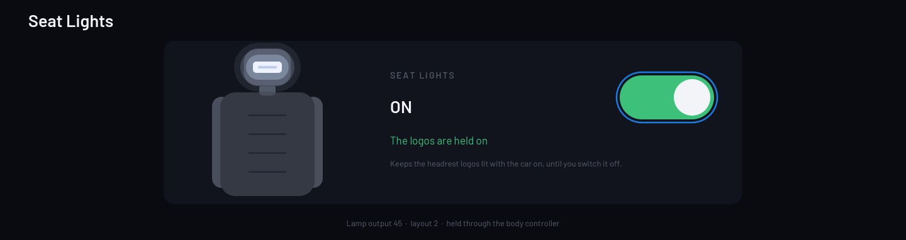

# Seat Lights: keep the seat logos on

An iDrive 8 app with one switch. **ON** keeps the illuminated logos in the seats' headrests lit with the car
on, with no timer, until you switch it **OFF**. Made for the G87 M2, whose logos go dark once the car is started.



> **⚠️ Experimental.** Holding the logos on was tested on a G87 M2 with [Light Logger](../lightlog)'s Keep on.
> This app does the same thing with the same code, but on its own. It hasn't been tested on a car yet.

## Use

1. In MGU Store, add the source `grabandrey/idrive-apps` (branch `main`) if you haven't, and install **Seat Lights**
   (`ida_seatlights`). For the drawn screen, also install **Renderer** (`mgu-render`) from MGU Store's own source.
   Without it, the screen is the head unit's plain list: a status line and a **Seat lights ON / OFF** row.
2. **The first time,** start the engine (so the logos are dark), open Seat Lights and switch it **ON**. It finds
   the record layout your body controller takes, saves it, and the logos light up.
3. That's it. The switch is kept: with it ON, the app starts with the head unit and the logos come on by themselves
   on every drive. Switch it **OFF** to give the logos back to the car.

If you use Light Logger too, switch its **Keep on** off. Both would hold the same output through the same
diagnostic session.

## How it works

On the G87 the logos hang on the body controller's (BDC, `0x40`) **lamp output 45**, element `0x2C` (the output
number minus one), found with Light Logger. Through the head unit's diagnostic link (`InternalTasu`), the way the
MIT-licensed [idrive7-apps](https://github.com/cauliflowermossgrape/idrive7-apps) kit drives these outputs:

| Step | Request |
|---|---|
| the lamp outputs, to check | `22 E3B9` (`22 4500` on older BDCs) |
| the extended diagnostic session | `10 03` |
| hold output 45 on | `2F E3B5 <layout, on>` (`2F 4501 …` on older BDCs) |
| keep the session, every 2 s | `3E 00` |
| hand it back (OFF, the app stopping), then the default session | `2F E3B5 <layout, back>`, `10 01` |

The G87 answered the kit's layout (`03 2C 01`) with "bad length", so the first time the switch goes ON the app
tries these in turn and keeps the first one the body controller takes **and** that lights output 45 (read back)
with no other output switching on:

| Layout | On | Back |
|---|---|---|
| 1, the kit's | `03 2C 01` | `00 2C 00` |
| 2, a 2-byte element | `03 00 2C 01` | `00 00 2C 00` |
| 3, a trailing byte | `03 2C 01 00` | `00 2C 00 00` |
| 4, a 2-byte state | `03 2C 00 01` | `00 2C 00 00` |

It only searches with the logos dark. If they're lit (before the engine starts), it waits. The layout is saved
and used directly from then on.

`uds.js` (Light Logger's, the same file) lets through reads, and these requests for output 45 only, to the body
controller only. Anything else is refused before it reaches the car.

| Situation | What the app does |
|---|---|
| output 45 reads OFF twice while ON (checked every 5 s) | asks again |
| the session is lost | opens it and asks again |
| 5 refusals in a row | gives up: the switch goes OFF and the screen says what the body controller answered |
| switched OFF | hands the output back and ends the session |
| the app stopping (car off, head unit shutting down) | hands it back; the switch stays ON for the next drive |
| the app crashing | nothing more is sent: the body controller ends the session after a few seconds and takes the output back by itself |

The body controller stays in a diagnostic session for as long as the switch is ON. If anything behaves oddly
(warnings, other lights, a diagnostic tool that can't connect), switch it OFF. Don't use a diagnostic or coding
tool on the car while it's ON.

Settings (`seatlights.json`: the switch, the layout, the identifier) are in the first writable folder of the app's
home, its working folder and the temp folder. Logs: the app's log (`STLT`), lines starting `seat lights:`.

## Package layout

```
app/                          the app (source package, id ida_seatlights, built on the head unit)
  mgu-app.json                id, version, modules, the oap-sdk modules it uses
  src/ida_seatlights.js       the app: the switch, the screen, the settings
  src/seat_light.js           holds lamp output 45 on: the layout search, the session, the checks
  src/ui.js                   the drawn screen
  src/uds.js, lamps.js, someip_link.js, gpu.js, ui_font.js
                              Light Logger's, copied as they are (an app gets only its own folder on the car);
                              tools/test_seatlights.js fails when they differ
  package/                    the staged package tree (generated by tools/gen_package.js)
  tools/test_seatlights.js    tests: the switch against a fake body controller, the copies, the screen, the package
  tools/preview_ui.js         writes design/app_preview.html (on | off | waiting)
```

Not affiliated with BMW. MIT licensed.
