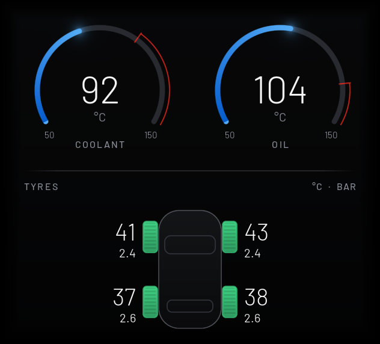

# Vitals: coolant, oil and tyre temperatures in the iDrive 8 cluster

A cluster widget for BMW iDrive 8, styled to match the car's own displays, installed from **MGU Store**.



- **Coolant** and **oil** temperature on thin arc gauges with a blue fill. A gauge turns red once its
  temperature passes a warning point you choose.
- **Tyres**: the car from above. Each tyre is coloured by its temperature (blue = cold, green = normal,
  orange = warm, red = hot), with its temperature and pressure beside it.
- °C / °F and bar / psi / kPa follow the car's own unit settings, or you can pick them yourself.
- Its own **Vitals** entry in the cluster's widget menu, with BMW's own artwork in the middle blacked out
  behind it.
- The **Vitals** app (Apps menu) reads the car's data and holds the settings.

> **⚠️ Experimental: not yet tested on a car.** The package follows the documented MGU Store and cluster-render
> formats and the car's documented data fields. Its code passes desktop tests against stand-ins for BMW's SDK
> and the renderer, and the shader compiles and renders under WebGL 1 / GLSL ES 1.00. But it hasn't run on a
> real iDrive 8 head unit yet, and MGU Store's own iDrive 8 support is also marked untested.
> Install at your own risk.

## How it fits together

```
 car (SOME/IP)          Vitals app (app/)                         widget service (tool/)                       cluster
 CDS  engine temps  -->  reads via BMW's SDK, decodes to C/bar  -->  view + text + shader               -->  cluster-render
 TPMS tyre temps/pressures   settings screen (Apps menu)   <-->     /run/ida-vitals-cluster/ctl.sock            widget "Vitals"
 Vehicle  display units
```

- **The app** runs as an ordinary iDrive app with BMW's SDK, so it can read the car's data. It declares
  `CDS.statusEngineTemperature`, `TPMS.statusTyreTemperature`, `TPMS.statusTyrePressure` and
  `Vehicle.statusNewCurrentUnitsStatusExt` in its `manifest.json`, and reads them through typed proxies.
  TPMS is also read every 5 s, because some cars answer reads but never send updates.
- **The widget service** runs as a root tool without the SDK. It draws every shape on the GPU with one
  fragment shader, and draws the numbers and labels into two 8-bit textures using a baked Barlow font.
  When a value changes, only that value's small rectangle is re-uploaded.

On iDrive 8, cluster-render can't replace the whole cluster. It draws a **widget in the middle, between
BMW's own gauges**. BMW keeps drawing the speedometer, rev counter, warning lights and driver assistance.

## Install (MGU Store)

1. Install **Cluster renderer** (`cluster-render`) 0.6.9 or newer from the official `robertnisipeanu/idrive-apps` source.
2. In MGU Store, go to **Settings → Add source**, enter `grabandrey/idrive-apps`, and pick the `main` branch
   (skip this if you already added it).
3. Install **Vitals Cluster** (`ida-vitals-cluster`) and **Vitals** (`ida_vitals`).
4. **Restart the head unit once.** cluster-render reads the Vitals widget entry only when it starts, and its
   README advises against restarting the service on its own on iDrive 8.
5. Open the **Vitals** app once, so it starts reading the car. Then pick **Vitals** in the cluster's widget menu.

Until the restart, the widget draws on cluster-render's generic `widget` entry (listed as "Cluster renderer").

**Data needs the app running.** The widget service has no access to the car's data itself. If the gauges show
dashes, open the Vitals app: its status line says whether engine and tyre data are arriving. Engine values go
to dashes 15 s after the last update (for example, with the car off). Tyre values last 3 minutes, because the
tyre sensors report slowly and, on some cars, only while driving.

## Settings (the Vitals app)

| Row | A press… |
|---|---|
| Temperature unit | Car setting → °C → °F |
| Pressure unit | Car setting → bar → psi → kPa |
| Coolant warning | 95 → 130 °C in 5° steps (default 115) |
| Oil warning | 110 → 150 °C in 5° steps (default 135) |
| Gauge colour | Blue → Light blue → White |
| Tyre pressures | Shown / Hidden |
| Dark backdrop | On / Off |
| Demo values | On / Off: a warm-up and a hot lap, to check the widget without driving |
| Reset to defaults | everything back |

Settings are stored in `/var/opt/ida-vitals-cluster/settings.json`. The file is kept over updates, can be edited by
hand, and is reloaded within 2 s. The service checks every value before using it, whoever sends it.

Logs: `journalctl -u ida-vitals-cluster` for the widget; the app logs under `VTLS`.

## Package layout

```
tool/                               the widget service (a root tool kit, id ida-vitals-cluster)
  component.json                    files, systemd unit, requirements, mguHmi ID8
  vitals.js                         the service (Node 8): settings, control socket, cluster-render layer + textures
  view.js                           settings + car data -> uniforms and text (units, warnings, staleness, demo)
  layout.js                         the geometry, shared by the shader and the text
  shader.js                         builds the GLSL ES 1.00 fragment shader from layout.js
  text.js                           text into 8-bit textures, with per-field dirty rectangles
  font.js                           baked Barlow glyphs (generated by scripts/bake_font.py)
  ida-vitals-cluster.service        systemd unit
  cluster-render.d/vitals.conf      cluster-render drop-in: the "Vitals" widget-menu entry
  preview.png                       widget-menu picture
app/                                the Vitals app (source package, id ida_vitals, built on the head unit)
  mgu-app.json                      id, version, modules, the oap-sdk modules it uses
  src/ida_vitals.js                 the app: settings screen, car data -> widget
  src/car_data.js                   CDS / TPMS / Vehicle through typed SOME/IP proxies
  src/decode.js                     the car's raw values -> C and bar
  src/settings_model.js             the settings rows
  src/ctl_client.js                 the widget service's control socket
  package/                          the staged package tree (generated by tools/gen_package.js)
  tools/test_model.js               tests: rows, the service's checks, decoding, the view
design/widget_preview.html          the widget in a browser, with the car's own code (demo data)
```

## Develop

- `node scripts/test_all.js` (from the repository root): all tests.
- `node packages/vitals/app/tools/gen_package.js`: after changing the app's screen, manifest or version.
- `python scripts/bake_font.py`: after changing the font styles (needs Pillow).
- Open `design/widget_preview.html` to see the widget with demo data. Add `?still&state=warm|cold|hot|nodata`
  for fixed states, and `&t=F&p=psi&accent=lightblue` for other settings.

## Credits

Built on [cluster-render](https://github.com/robertnisipeanu/idrive-apps/tree/main/native/cluster-render) and
[MGU Store](https://github.com/robertnisipeanu/mgu-store). The data fields and their scaling are as documented by the
MIT-licensed [BMW cluster themes](https://github.com/shezj/bmw-cluter-themes) kit. Font: [Barlow](https://github.com/jpt/barlow)
(SIL OFL 1.1).

Not affiliated with BMW. No BMW artwork, fonts, logos or trademarks are used. The look is inspired by the car's own
displays, not copied from them.

MIT licensed (the fonts keep their own licence).
